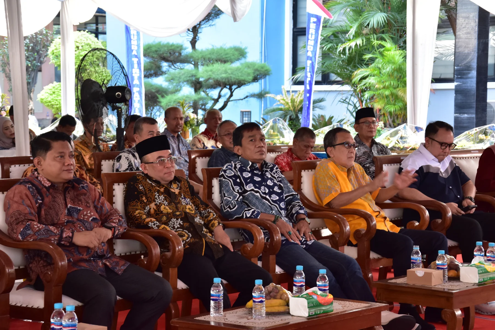
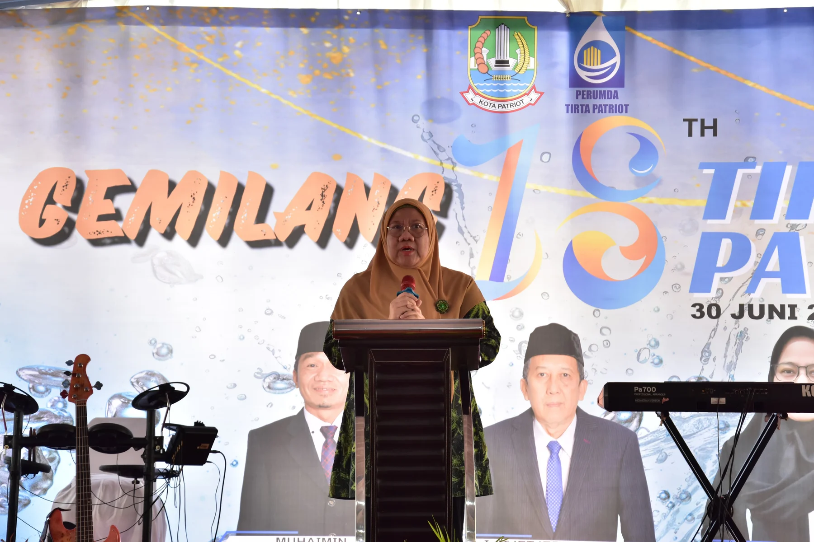

Perumda Tirta Patriot merayakan ulang tahun yang ke-18 dengan mengadakan berbagai rangkaian acara yang meriah dan penuh makna. Perayaan ini dihadiri oleh Staf Ahli Wali Kota Bidang Ekonomi, Pembangunan dan Kemasyarakatan Dr. Reny Hendrawaty, M.M yang mewakilkan PJ. Walikota Bekasi serta H. Abdul Muin Hafied, S.E., M.Pd (anggota Komisi III DPRD Kota Bekasi), Drs.Dinar Faizal Badar (Kepala Bapelitbangda), Chondro Wibhowo Mahartoyo Sukmo, S.E (Kabag Ekonomi), Sumpono Brama, S.STP, M.Si (Camat Bekasi Utara), dan Makpudin, S.Ap (Lurah Margamulya) ikut menyemarakkan acara tersebut.

Acara dibuka dengan sambutan yang hangat dan penuh semangat dari Ali Imam Faryadi selaku Direktur Utama Perumda Tirta Patriot. Dalam pidatonya yang sarat makna, beliau tidak hanya menyampaikan rasa syukur yang mendalam atas pencapaian perusahaan ini, tetapi juga mengungkapkan penghargaan yang tulus kepada semua pihak yang telah berperan serta dalam membangun dan mengembangkan Perumda Tirta Patriot selama 18 tahun terakhir.

“Alhamdulillah, meningkatnya profesional ketenagakerjaan atau kepegawaian tahun 2023 kami mencapai 85,7 persen. Artinya meningkat sebesar 55 % daripada tahun 2022 yang hanya mencapai sekitar 26%. Ini menunjukkan konsisten dan komitmen kami. Bagaimana menciptakan sebuah doktrin terkait fungsi dasar dan tujuan dasar di bentuk perusahaan yang namanya BUMD Air Minum,” ujar Ali Imam di Kantor Utama Perumda Tirta Patriot.

Sambutan Ali Imam tersebut mencerminkan visi dan nilai-nilai yang telah menjadi landasan kuat perusahaan dalam menghadapi berbagai tantangan dan peluang di masa depan. Dengan semangat yang membara, beliau mengajak seluruh jajaran manajemen dan seluruh karyawan Perumda Tirta Patriot untuk terus bersatu padu dan bergerak maju.

Rangkaian acara perayaan ini meliputi berbagai kegiatan seperti Creative Fashion Show, Music Performance, hingga pengundian Door Prize untuk seluruh karyawan dan pegawai yang ada dilingkungan Perumda Tirta Patriot. Creative Fashion Show yaitu perlombaan antar bagian yang menampilkan kreativitas, keunikan dan kekompakan para karyawan sebagai Tukang Ledeng. Yang diharapkan dengan adanya lomba ini semakin memperkuat etos kerja di bagiannya masing-masing.
 
 
 
Puncak acara ditandai dengan pemotongan tumpeng oleh Reny Hendrawaty - Staf Ahli Wali Kota Bidang Ekonomi, Pembangunan dan Kemasyarakatan sebagai simbol rasa syukur dan harapan atas pencapaian yang telah diraih Perumda Tirta Patriot selama 18 tahun terakhir, tetapi juga menegaskan komitmen untuk mendorong perusahaan ini agar terus berkembang dan memberikan manfaat yang lebih besar bagi masyarakat. Perayaan HUT ke-18 menjadi momentum bagi Perumda Tirta Patriot untuk mengevaluasi pencapaian dan merencanakan langkah-langkah strategis ke depan. Dengan semangat yang baru, Perumda Tirta Patriot siap melayani masyarakat dengan lebih baik.
