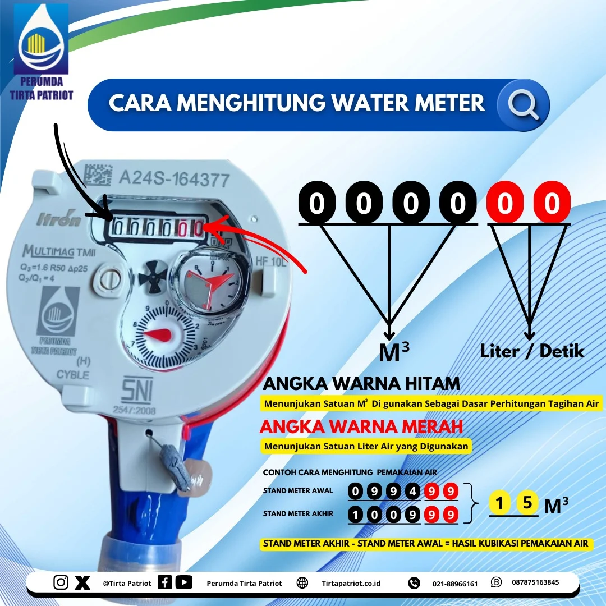

Hi Sahabat Patriot,

Cara Membaca Meter Air : 
Sebagai pengguna meter air proses membaca nya terbilang mudah dan sederhana, hanya perlu memeriksa angka di meteran yang berwarna hitam (satuan M³/kubik) dan berwarna merah (satuan Liter/detik)

Cara Menghitung Meter Air :
Stand Meter Akhir (M³) - Stand Meter Awal (M³) = Hasil Kubikasi Pemakaian Air

#PerumdaTirtaPatriot
#HumasTirtaPatriot
